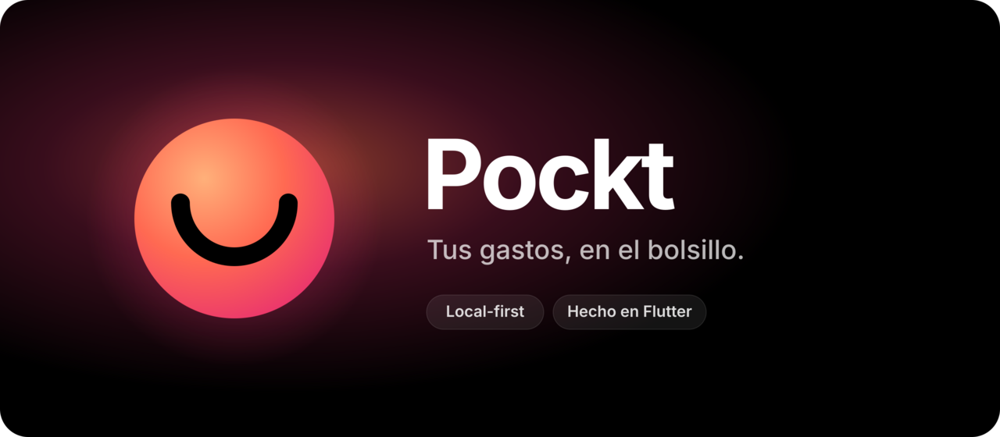
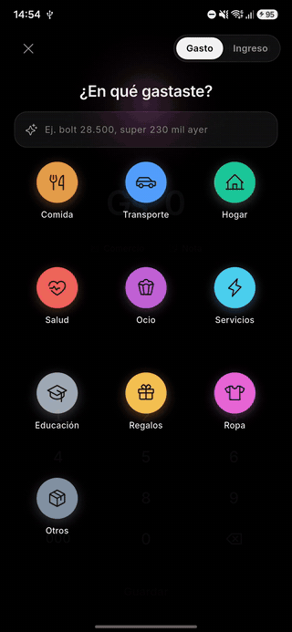
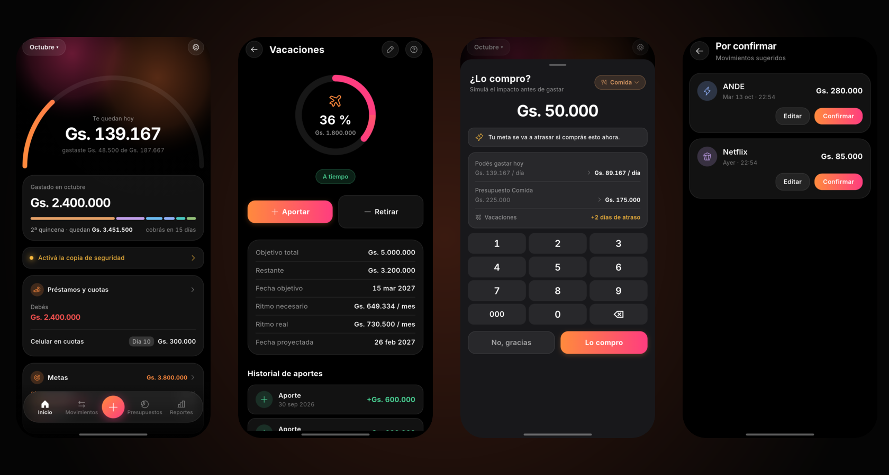
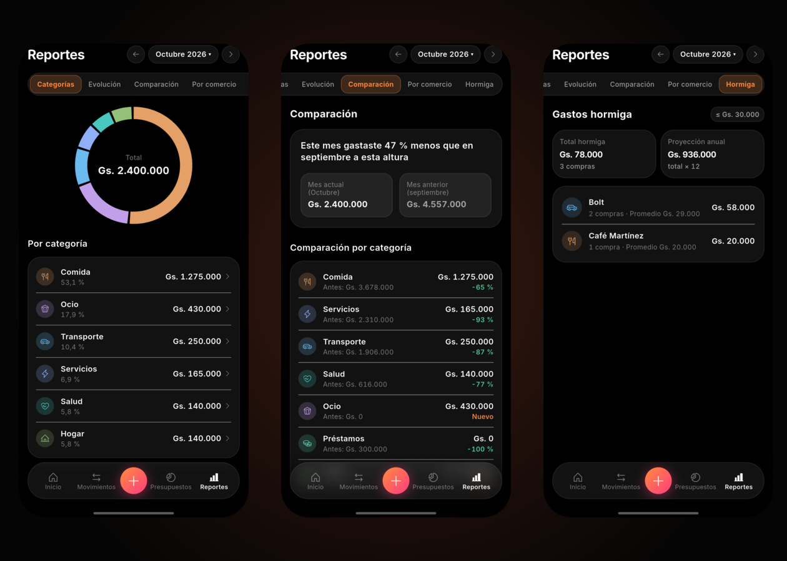

<div align="center">

<picture>
  <source media="(prefers-color-scheme: dark)" srcset="docs/brand/readme/banner-dark.png">
  <source media="(prefers-color-scheme: light)" srcset="docs/brand/readme/banner-light.png">
  
</picture>

<br>

Una app de finanzas personales para Android, **rápida para anotar y hermosa de usar**.

[](https://flutter.dev)
[](https://dart.dev)
[](https://www.android.com)
[](#privacidad)
[](#estado)

<br>



<sub><i>Cargar un gasto: categoría, monto, listo.</i></sub>

</div>

<br>

<picture>
  <source media="(prefers-color-scheme: light)" srcset="docs/brand/readme/gallery-light.png">
  
</picture>

<p align="center"></p>

---

## Qué es Pockt

Pockt nace de una idea simple: si anotar un gasto tarda, dejás de anotarlo. Por eso todo gira alrededor de cargar un gasto en **tres toques**, y de que mirar tus finanzas sea algo que *querés* hacer.

- **Categoría primero.** Tocás la burbuja de la categoría, se transforma en el teclado con su color, ponés el monto y listo.
- **Texto natural que aprende.** Escribís `super 230 mil ayer` o `bolt 28.500` y Pockt lo entiende. Cada comercio que guardás queda en una libreta local: la próxima vez ya sabe su categoría, y tolera errores de tipeo.
- **Tus días, a la vista.** Un calendario de calor del mes, al estilo de las contribuciones de GitHub, que muestra en qué días gastaste más. Tocás un día y ves en qué se fue.
- **Presupuestos por categoría** con anillos de progreso y notificaciones al 80 % y al 100 % (una sola vez por mes).
- **Recurrentes y cobros** que te esperan en una bandeja para confirmar, sin cargarse a ciegas. Entiende el cobro quincenal real: si el 15 cae en fin de semana o feriado, puede ser el día hábil anterior o el siguiente, y el "quedan" arranca el día que cobraste de verdad.
- **Recordatorios con intensidad**: de "suave" a "insistente", con textos que cambian cada día, y solo si ese día no anotaste nada.
- **Widget y acceso rápido**: tus 4 categorías más usadas en la pantalla de inicio y un tile en el panel de ajustes rápidos para anotar sin abrir la app.
- **Sueldo mensual con reparto**: por ejemplo 30 % el 15 y 70 % a fin de mes; cada cobro se sugiere con su monto.
- **Reportes**: mes por categoría, evolución, comparación con el mes anterior a la misma altura, ranking por comercio y **gastos hormiga** (lo chico y frecuente, con lo que suma en un año).
- **Podés gastar hoy**: el número grande del inicio es cuánto podés gastar por día hasta el próximo cobro, ya descontados los gastos por confirmar, las recurrentes que vienen y lo que tus metas necesitan. Si preferís, se cambia por "Gastado en el mes".
- **Saldo arrastrado**: si te pasaste en la quincena, la siguiente lo descuenta; si te sobró, Pockt te ofrece pasarlo a una meta o sumarlo.
- **Metas de ahorro**: objetivo, fecha, ritmo necesario y proyección a tu ritmo real ("a tiempo" o "N meses tarde"). Los aportes se apartan de lo que te queda y aparecen en Movimientos sin contar como gasto.
- **¿Lo compro?**: mantené apretado el **＋** y mirá el antes y el después de una compra: cuánto podrías gastar hoy, cómo queda el presupuesto y cuántos días se atrasan tus metas. Con tono suave, normal o picante.
- **Préstamos y cuotas**: lo que debés, lo que prestaste y las compras en cuotas, con avance, pagos extra y aviso de vencimiento.
- **Sueldo con descuentos**: bruto, descuentos fijos o en porcentaje, y el neto de cada cobro.
- **Atajos de carga**: tus gastos repetidos (el almuerzo, el Bolt) a un toque.
- **Eventos**: agrupá los gastos de un viaje o una fiesta y mirá cuánto costó.
- **Resumen semanal** opcional el domingo.

## Diseño

Identidad propia, **"Profundidad y luz"**: negro puro para pantallas AMOLED (y modo claro), un resplandor tipo aurora que toma el color de la categoría donde más gastaste y se tiñe de ámbar o rojo si te acercás al presupuesto, superficies de vidrio y animaciones con física.

## Privacidad

- **Local-first**: tus datos viven en tu teléfono (SQLite).
- **Copia de seguridad cifrada** (AES-256-GCM) automática cada 48 horas en `Documentos/Pockt` del teléfono, que sobrevive a desinstalar la app. La clave sale de una contraseña que solo vos conocés. Podés exportar una copia y compartirla donde quieras, y restaurar desde cualquier archivo `.pockt`.
- **Bloqueo opcional** con huella o PIN y opción de **ocultar montos** hasta tocar el total.
- **Sin servidor, sin analíticas, sin publicidad.**

## Stack

**La app**

- **[Flutter](https://flutter.dev) 3.47 + Dart 3.13** — el framework. Dibuja cada píxel con su propio motor (Impeller), lo que permite un diseño 100 % propio y animaciones fluidas.
- **[Inter](https://rsms.me/inter/)** — la tipografía, incluida dentro de la app. Con cifras tabulares: todos los dígitos miden lo mismo, así los montos no "bailan" mientras escribís.

**Datos**

- **[Drift](https://drift.simonbinder.eu)** — base de datos SQLite tipada y reactiva. Guarda gastos, categorías y presupuestos, y avisa sola a cada pantalla cuando algo cambia.
- **[uuid](https://pub.dev/packages/uuid)** — identificadores únicos para cada registro; facilitan backups y una futura sincronización.

**Estado**

- **[Riverpod](https://riverpod.dev)** — conecta los datos con las pantallas: el total del inicio "escucha" a la base y se actualiza solo al cargar un gasto.

**Notificaciones**

- **[flutter_local_notifications](https://pub.dev/packages/flutter_local_notifications)** — alertas de presupuesto y avisos de cobros y recurrentes.

**Fechas y formatos**

- **[timezone](https://pub.dev/packages/timezone) + [flutter_timezone](https://pub.dev/packages/flutter_timezone)** — toman la zona horaria del teléfono, para que un gasto de las 23:30 caiga en el día correcto aunque internamente se guarde en UTC.
- **[intl](https://pub.dev/packages/intl)** — fechas en español ("Viernes 17 de octubre").

**Desarrollo y calidad**

- **[build_runner](https://pub.dev/packages/build_runner) + drift_dev + riverpod_generator** — generan el código repetitivo (consultas tipadas, providers) para no escribirlo a mano.
- **[flutter_test](https://docs.flutter.dev/testing) + [mocktail](https://pub.dev/packages/mocktail)** — tests unitarios, de base de datos y de widgets. La lógica de fechas y montos se escribe con tests primero.
- **integration_test** — mide los tiempos de cada frame en un teléfono real (en una variante aparte, sin tocar tus datos).

**Seguridad y respaldo**

- **[cryptography](https://pub.dev/packages/cryptography)** — cifrado AES-256-GCM con clave derivada por Argon2id.
- **[flutter_secure_storage](https://pub.dev/packages/flutter_secure_storage)** — guarda la clave derivada en el almacén seguro de Android.
- **[local_auth](https://pub.dev/packages/local_auth)** — bloqueo con huella o PIN.
- **[share_plus](https://pub.dev/packages/share_plus)** — exportar una copia o un CSV a cualquier app.

**Sistema**

- **[workmanager](https://pub.dev/packages/workmanager)** — tareas en segundo plano (avisos de presupuesto, recordatorios).
- **[home_widget](https://pub.dev/packages/home_widget)** — widget de pantalla de inicio con tus categorías más usadas.
- **[phosphor_flutter](https://pub.dev/packages/phosphor_flutter)** — los íconos de toda la app.

## Arquitectura

```
lib/
  core/        sistema visual, base de datos, formatos y fechas
  features/    una carpeta por funcionalidad (entry, home, transactions, budgets, …)
```

Cada funcionalidad tiene tres capas: **datos** (repositorios Drift), **lógica** (providers Riverpod con streams reactivos) y **UI** (widgets que solo muestran y animan). Las funcionalidades no se importan entre sí: se comunican a través de la base de datos.

El diseño completo está en [`docs/superpowers/specs/`](docs/superpowers/specs/) y los planes de implementación en [`docs/superpowers/plans/`](docs/superpowers/plans/).

## Estado

| Etapa | Contenido | |
|---|---|---|
| **Plan 1** | Base, carga de gastos, inicio, calendario de calor, movimientos, texto natural que aprende | ✅ v0.1 |
| **Plan 2** | Presupuestos, recurrentes, cobro quincenal con días hábiles y feriados, bandeja de sugeridos, Ajustes | ✅ v0.2 |
| **Plan 3** | Reportes, recordatorios, apariencia, logotipo y apertura animada, widget y acceso rápido | ✅ v0.3 |
| **Plan 4** | Copia cifrada local automática, restauración, bloqueo con huella, primer uso | ✅ |
| **Plan 4b** | Ajustes por secciones y descuentos del sueldo | ✅ |
| **Plan 4c** | Préstamos y compras en cuotas: avance, pagos y vencimientos | ✅ |
| **Plan 5** | Metas, Podés gastar hoy, ¿Lo compro?, saldo arrastrado, gastos hormiga, atajos, resumen semanal y eventos | ✅ v0.5 |
| **Plan 6** | Pulido visual de las pantallas nuevas | 🔨 |
| **Después** | Motor de captura: leer notificaciones de bancos, SMS y correos | 💡 |
| **Después** | Otras monedas e idiomas (hoy: guaraníes y español) | 💡 |

## Desarrollo

Requisitos: Flutter 3.47 estable y un dispositivo o emulador Android 8.0+.

```bash
git clone https://github.com/Pacotez12/pockt.git
cd pockt
flutter pub get
dart run build_runner build --delete-conflicting-outputs   # código generado de Drift
flutter test
flutter run
```
